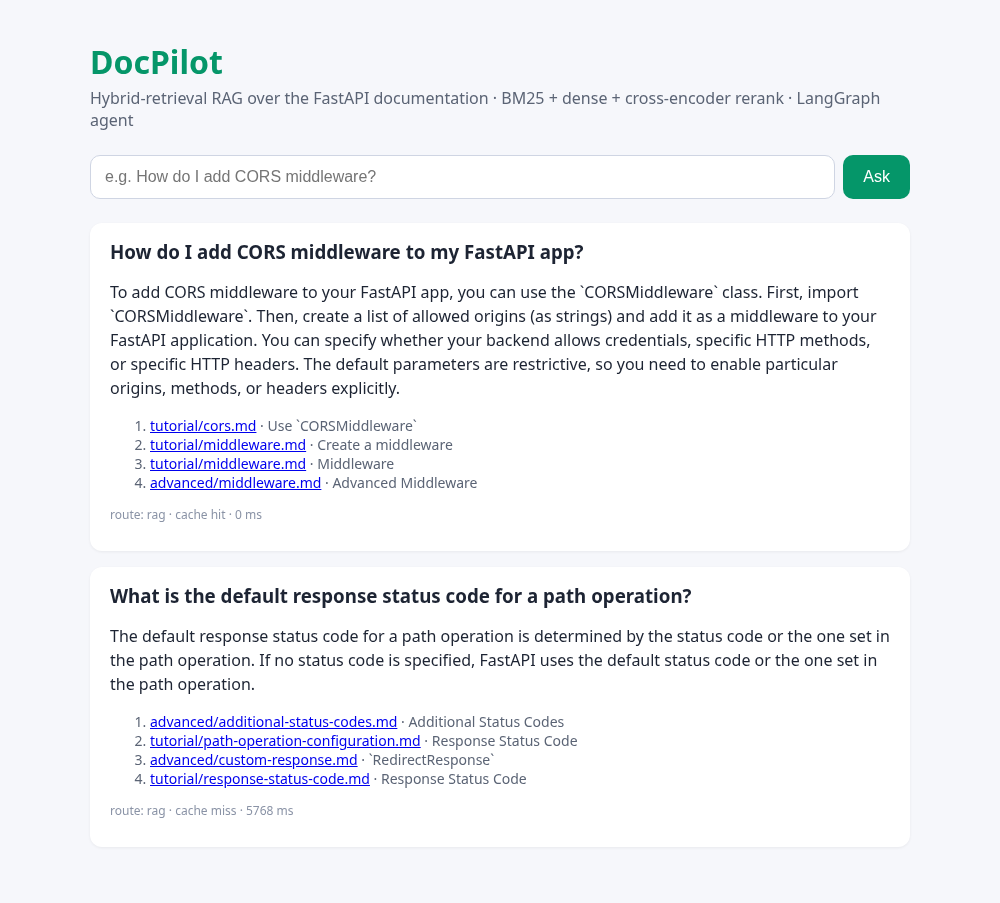
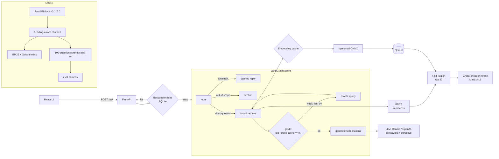

# DocPilot: a hybrid-retrieval RAG and LangGraph agent with evals

   

DocPilot answers developer questions about the **FastAPI documentation** (MIT-licensed, pinned to v0.115.0: 139 pages, 1,273 chunks). It cites its sources and runs entirely on CPU:

- **Hybrid retrieval.** A from-scratch Okapi **BM25** plus **dense** retrieval (`BAAI/bge-small-en-v1.5` in **Qdrant**), fused with Reciprocal Rank Fusion.
- **Cross-encoder reranker** (`ms-marco-MiniLM-L-6-v2`, ONNX via fastembed) re-scores the top 20 candidates.
- **LangGraph agent.** It routes small talk and out-of-scope questions away from retrieval. A grading step checks the reranker's top score; if evidence is weak, it **rewrites the query** once and retries.
- **Two-level caching** in SQLite: query embeddings and full responses.
- **Pluggable LLM**: local **Ollama** model, any **OpenAI-compatible** API, or `none` (extractive answers).
- **FastAPI** backend plus a minimal **React (Vite)** UI, a **Dockerfile** that bakes in the index, and **Cloud Run / ECS Fargate** configs.
- **Eval harness**: a retrieval ablation on 100 questions (Recall@k, MRR), plus a generation ablation (faithfulness, answer relevance, context hit rate@4) with latency and token cost, cache on vs off.

> Every number below comes from this repo's eval scripts, run on a shared 8-vCPU CPU-only box. Raw outputs are in `reports/`. The LLM for the generation evals was **Qwen2.5-1.5B-Instruct (Q4_K_M GGUF) via Ollama**.



## Architecture



## Results

### Test set

`eval/testset.jsonl` holds **100 synthetic questions**, each generated by Qwen2.5-1.5B from a different randomly sampled chunk (seed 7, prose-heavy chunks of at least 400 characters). They come from **100 distinct doc pages**. The source chunk is the ground truth. Malformed questions are filtered out automatically, but the questions were not reviewed by hand.

### 1. Retrieval ablation (all 100 questions, top-10 returned)

| Retriever | Recall@1 | Recall@3 | Recall@5 | Recall@10 | MRR@10 | Page Hit@5 | p50 latency | p95 latency |
|---|---|---|---|---|---|---|---|---|
| BM25 | 0.67 | 0.88 | 0.91 | 0.94 | 0.773 | 0.96 | 0.6 ms | 2.2 ms |
| Dense (bge-small) | 0.59 | 0.78 | 0.81 | 0.92 | 0.698 | 0.92 | 68 ms | 99 ms |
| Hybrid (RRF) | 0.70 | **0.89** | **0.94** | **0.97** | 0.796 | 0.96 | 76 ms | 112 ms |
| BM25 + rerank | **0.79** | 0.87 | 0.93 | 0.96 | **0.845** | 0.95 | 1,851 ms | 2,656 ms |
| Dense + rerank | 0.78 | 0.87 | 0.91 | 0.94 | 0.836 | 0.95 | 2,797 ms | 3,437 ms |
| Hybrid + rerank | **0.79** | 0.87 | 0.92 | 0.95 | 0.843 | **0.96** | 2,073 ms | 2,704 ms |

*Recall@k means the gold chunk is in the top k (one gold chunk per question). Page Hit@5 means any chunk from the gold page is in the top 5. Latency is retrieval only, with the embedding cache off.*

- **Hybrid beats either retriever alone:** Recall@10 is 0.97 vs 0.94 for BM25 and 0.92 for dense.
- **Reranking moves the right chunk to the top:** Recall@1 rises from 0.70 to 0.79 and MRR from 0.796 to 0.843. That costs about 2 s per query on this CPU, and Recall@10 dips slightly (0.97 to 0.95).
- **BM25 is unusually strong here.** The questions were generated from the chunks, so they share vocabulary with them; this is a known bias of synthetic test sets.

### 2. Generation ablation (25-question seeded subset, end to end through the agent)

| Config | Faithfulness | Answer relevance | Context hit rate@4 (gold passage in top-4 context) | p50, cache off | p95, cache off | p50 / p95, cache on (repeat queries) | Avg prompt / completion tokens |
|---|---|---|---|---|---|---|---|
| Hybrid, no rerank | **0.427** | 0.904 | 0.76 (19/25) | **5.6 s** | **9.7 s** | 0.1 ms / 0.1 ms | 750.9 / 64.5 |
| Hybrid + rerank | 0.416 | **0.918** | **0.88 (22/25)** | 9.5 s | 87.4 s* | 0.1 ms / 0.1 ms | 758.1 / 77.9 |

How each metric is measured:
- **Faithfulness** is the share of answer sentences entailed (P ≥ 0.5) by at least one passage the LLM saw, scored with the `cross-encoder/nli-deberta-v3-xsmall` NLI model.
- **Answer relevance** is the cosine similarity between the bge-small embeddings of the question and the answer.
- **Context hit rate@4 (gold passage in top-4 context)** is the share of questions whose gold passage was among the 4 passages given to the LLM. It is a retrieval measure and says nothing about whether the generated answer was correct.
- **Cache on** means the same 25 questions were replayed after the cold pass: 25/25 response-cache hits, 0 LLM calls.

Median latency per stage with the cache off (`reports/generation_eval.md`):

| Config | Retrieval | Rerank | LLM generate |
|---|---|---|---|
| Hybrid, no rerank | 66 ms | 0 ms | 5,535 ms |
| Hybrid + rerank | 112 ms | 1,380 ms | 6,560 ms |

\*The 87 s p95 comes from two LLM calls that stalled for 95–107 s while other jobs were competing for the box's CPU. Their retrieval and rerank stages took about 1.5 s, as usual. Treat the p95 column as noisy; the per-stage medians are the reliable comparison.

**Takeaways**
- The reranker raises the **context hit rate@4 (gold passage in top-4 context) from 0.76 (19/25) to 0.88 (22/25)**, so the gold passage reaches the LLM more often. This does not measure answer correctness. Answer relevance improves slightly (0.904 → 0.918).
- Measured faithfulness did **not** improve (0.427 vs 0.416, within noise for n = 25). With a 1.5B model, the bottleneck is the generator paraphrasing beyond the context, not retrieval.
- The response cache turns a 5.6–9.5 s median answer into a **0.1 ms** lookup for repeated questions.

### 3. Cost

Token counts are measured: about 751–758 prompt and 65–78 completion tokens per answer. Local Ollama inference has no API cost. For an API model, `eval/summarize.py` multiplies the **measured** tokens by a price you supply. At an *assumed* $0.15 / $0.60 per 1M input/output tokens:

| Config | Est. cost per 1,000 queries, cache off | Cache on, repeated queries |
|---|---|---|
| Hybrid, no rerank | $0.15 | $0.00 (0 LLM calls measured) |
| Hybrid + rerank | $0.16 | $0.00 (0 LLM calls measured) |

The reranker costs CPU time (about 1.4 s median), not tokens. It still sends 4 passages; it just picks better ones.

## Design decisions and trade-offs

- **Hybrid retrieval with RRF instead of a weighted score sum.** BM25 scores and cosine similarities aren't on the same scale. RRF uses ranks only, so there's no weight to tune, and it was the best first-stage retriever here (Recall@10 0.97).
- **BM25 written from scratch** (`src/docpilot/bm25.py`). It's about 50 lines, has no dependency, runs in 0.6 ms median per query over 1,273 chunks, and is easy to explain in an interview.
- **Retrieve 20, rerank, keep 4.** A cross-encoder reads query and passage together, so it's accurate but O(candidates). Twenty candidates balances recall and CPU latency. The eval shows the trade-off: +0.09 Recall@1 for about 2 s.
- **Routing without an LLM.** A regex and domain-vocabulary router costs microseconds. An LLM router would add a full model call (seconds here) to every request. The grade-and-rewrite loop uses the reranker score that's already computed, and it's capped at one retry to bound latency.
- **Caching at two levels.** The embedding cache skips the ONNX query encoder. The response cache, keyed on normalised question + retriever mode + reranker flag + model, skips the whole graph. Both live in SQLite (WAL mode), so they survive restarts and are shared across workers. A semantic (embedding-similarity) cache is a deliberate next step: it raises hit rates but risks serving stale or wrong answers.
- **Heading-aware chunking.** Chunks never split inside a code block, and each carries its "Page > Section" path. That helps both BM25 and the reranker, and it lets citations name the section.
- **Pluggable LLM behind a tiny interface.** The same code runs a local 1.5B model for development and evals, or a hosted model in production (key from Secret Manager / AWS Secrets Manager). Every call reports token usage, so cost is measured, not guessed.
- **Cheap, reproducible generation metrics.** NLI-based faithfulness and embedding relevance need no LLM judge, so the eval can run on CPU. The trade-off is that they're stricter and noisier than an LLM judge (see limitations).

## Quickstart

```bash
python -m venv .venv && source .venv/bin/activate
pip install -r requirements-dev.txt
cp .env.example .env                       # choose ollama / openai / none
make corpus                                # download + chunk FastAPI docs (pinned v0.115.0)
make serve                                 # FastAPI on :8000 (builds the index on first request)
make ui                                    # React dev server on :5173 (proxies to :8000)
make eval-retrieval                        # 100-question retrieval ablation -> reports/retrieval_eval.md
make eval-generation                       # generation ablation + latency/cost -> reports/generation_eval.md
make test                                  # 11 tests, no model downloads needed (hashing fake embedder)
```

With Ollama: `ollama pull qwen2.5:1.5b-instruct`, then set `DOCPILOT_LLM_PROVIDER=ollama`. API endpoints: `POST /ask {"question": ...}`, `GET /search?q=...&mode=hybrid|bm25|dense&rerank=true`, `GET /health`.

## Deploy (configs only; not deployed from this repo)

- **Docker:** a multi-stage build compiles the React UI, then a slim Python runtime. `scripts/warmup.py` runs at build time to bake in the corpus, the ONNX models and an on-disk Qdrant index, so cold starts don't re-embed. The container runs as a non-root user.
- **GCP Cloud Run:** `PROJECT_ID=... deploy/gcp/deploy.sh` or `deploy/gcp/service.yaml`. The LLM key comes from Secret Manager.
- **AWS ECS Fargate:** `deploy/aws/deploy.sh` with `deploy/aws/task-definition.json`. The key comes from Secrets Manager.
- **Qdrant:** in-memory by default. `DOCPILOT_QDRANT_PATH` gives embedded on-disk storage; `QDRANT_URL` / `QDRANT_API_KEY` point at a managed cluster.
- **CI:** the GitHub Actions workflow (ruff + pytest, frontend build, Docker build) is in `ci/github-actions-ci.yml`. To enable it, copy it to `.github/workflows/ci.yml`.

No credentials are committed; `.env.example` only lists variable names.

## How to talk about this in an interview

- **"Why hybrid?"** Show the table. BM25 is the strongest single retriever on this corpus, but dense retrieval finds complementary hits, so RRF fusion gets the best Recall@10 (0.97 vs 0.94 / 0.92) without tuning weights. The intuition to explain is that lexical matching catches exact API names and dense matching catches paraphrases.
- **"Was the reranker worth it?"** Retrieval: Recall@1 0.70 → 0.79, MRR 0.796 → 0.843, context hit rate@4 (gold passage in top-4 context) 0.76 → 0.88 (19/25 → 22/25), which is a retrieval number, not answer correctness. Cost: about 1.4 s of CPU per query. Then the honest part: faithfulness didn't move with a 1.5B generator. That tells you where to invest next (generator quality), and it's exactly what ablations are for.
- **"How do you evaluate RAG without labels?"** Synthetic question generation with known source chunks gives retrieval labels for free. Name the bias it introduces (lexical overlap favours BM25) and how to fix it: hand-written or user-log questions.
- **"How would you cut latency and cost?"** The response cache took repeats from seconds to 0.1 ms with zero tokens. Beyond that: a semantic cache, a GPU or hosted LLM for generation (the dominant stage at 5.5–6.6 s here), fewer rerank candidates, and streaming tokens to the UI.
- **"Why LangGraph?"** It makes the control flow explicit and testable (route, retrieve, grade, rewrite, generate) instead of one opaque chain. Each node is unit-testable, and adding a tool such as code search is a new node, not a rewrite.

## Limitations

- **Small generation subset.** It's 25 questions, so differences of a few points in faithfulness and relevance are within noise. The full 100 were used only for retrieval.
- **The test set is synthetic and unreviewed.** Its lexical overlap with source chunks inflates BM25 relative to real user queries.
- **The faithfulness metric is strict.** An xsmall NLI model often marks correct paraphrases or summaries as "not entailed". Use it to compare configs, not as an absolute quality score. Answer relevance (cosine) has a compressed range (about 0.9 for most answers).
- **Latency comes from a shared, loaded CPU box.** p95 values include contention stalls. A dedicated machine or GPU would be much faster.
- **The 1.5B model sometimes gives vague answers** (see the second question in the screenshot). A larger or hosted model is a one-variable change.
- **Code examples are missing from the corpus.** FastAPI v0.115 docs pull them from `docs_src/` include directives, which aren't indexed yet.

## Repository layout

```
src/docpilot/   corpus.py · bm25.py · retrieval.py (hybrid + rerank) · agent.py (LangGraph) · cache.py · llm.py · api.py · service.py
eval/           build_testset.py · run_retrieval_eval.py · run_generation_eval.py · summarize.py · testset.jsonl
frontend/       React + Vite UI
deploy/         Cloud Run + ECS Fargate
ci/             GitHub Actions workflow (copy to .github/workflows/ to enable)
reports/        every number quoted above
```

## Licence

Code: MIT. Corpus: the [FastAPI documentation](https://github.com/fastapi/fastapi) (MIT), downloaded at runtime and not committed.
